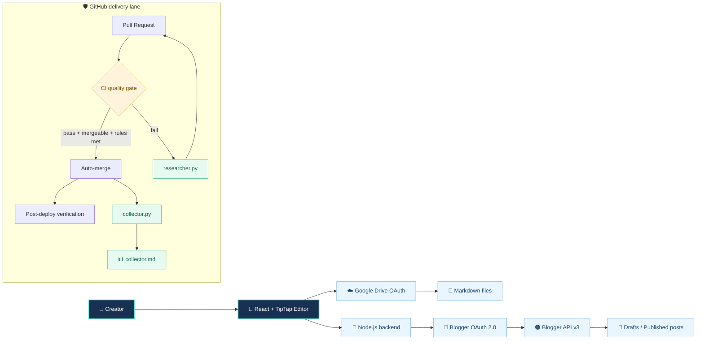
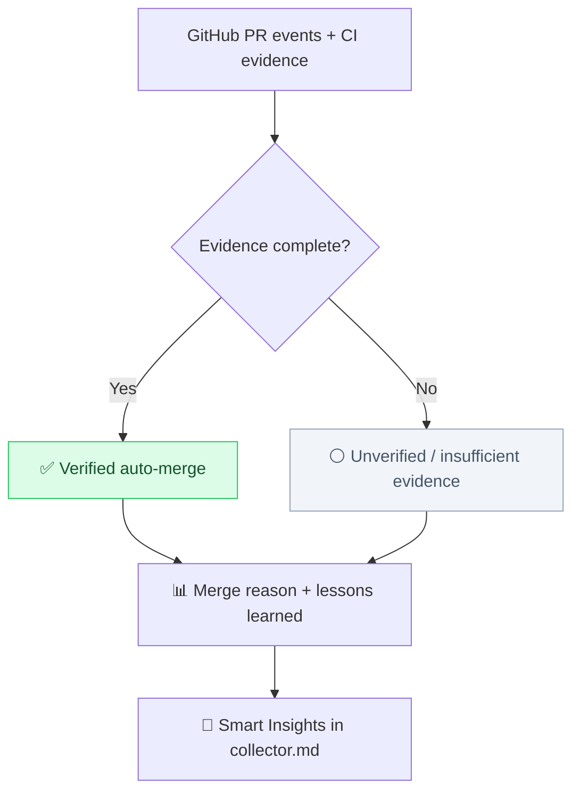
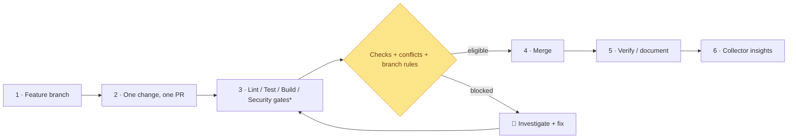

<div align="center">


<br />

[](https://github.com/duykhang68/tetdinhmuiblog/actions/workflows/ci.yml)
[](https://github.com/duykhang68/tetdinhmuiblog/actions/workflows/post-deploy-verify.yml)


**A creator-first editing workspace, backed by Google and guarded by GitHub automation.**

[🚀 Bắt đầu](#-quick-start) · [🗺️ Kiến trúc](#️-system-blueprint) · [📊 Insights](#-smart-insights) · [🛡️ CI/CD](#️-delivery-pipeline) · [📚 Hướng dẫn đầy đủ](docs/LEGACY-SETUP.md)

</div>

---

## ☁️ Quy định bắt buộc — Google Drive cho mọi trang dữ liệu

**Tất cả trang thống kê, Insights, dashboard, chi phí/tài chính và quản lý dữ liệu** phải có **Google Drive sync**: kết nối OAuth chung, tự đồng bộ 3 phút khi trang mở, nút **Đồng bộ ngay**, hiển thị trạng thái, sao lưu/khôi phục đa thiết bị và xử lý xung đột an toàn. Quy định áp dụng cho các trang mới và mọi trang hiện có khi được cập nhật; các trang cũ thiếu tính năng phải được triển khai bổ sung trong PR riêng.

**Đọc rule:** [AGENTS.md](AGENTS.md) · [Chính sách chi tiết & bảng theo dõi trang hiện có](docs/GLOBAL-GOOGLE-DRIVE-SYNC-POLICY.md) · [Checklist trong PR](.github/PULL_REQUEST_TEMPLATE.md).

## ✨ Creator workspace

<table><tr><td width="50%" valign="top">

### 📝 Write beautifully
Trình soạn thảo **React + TipTap**, hỗ trợ Compose, HTML, Preview, tags, lưu nháp và xuất bản có xác nhận.

**Flow:** Idea → Draft → Review → Publish.

</td><td width="50%" valign="top">

### ☁️ Connect intentionally
**Blogger API v3** cho bài viết; **Google Drive OAuth** cho luồng lưu/mở Markdown cục bộ. Hai chế độ có cấu hình xác thực khác nhau.

**Safety:** Không commit secrets. Không tự Publish.

</td></tr><tr><td valign="top">

### 🛡️ Ship with evidence
PR được kiểm tra qua CI, tự động hóa merge có điều kiện và bước xác minh sau deploy. **Không mặc định coi mọi lần merge là auto-merge.**

</td><td valign="top">

### 🧠 Learn from failures
`researcher.py` nghiên cứu lỗi; `collector.py` tổng hợp bằng chứng auto-merge, lý do và bài học trong `collector.md`.

</td></tr></table>

## 🗺️ System blueprint

> Sơ đồ Mermaid render trực tiếp trên GitHub. Luồng Blogger và luồng Drive là hai nhánh khác nhau, tránh nhầm token và cấu hình.



<details><summary><b>🔍 Architecture notes</b></summary>

- **Drive mode:** browser OAuth, token ở RAM trình duyệt; không cần backend hay Client Secret cho thao tác Drive trực tiếp.
- **Blogger mode:** backend quản lý phiên đã mã hóa, cookie/session và CSRF; đăng bài yêu cầu người dùng xác nhận.
- **Delivery lane:** chart là mô hình luồng dự kiến; trạng thái thực tế được xác nhận qua GitHub Actions và collector, không phải suy ra từ sơ đồ.

</details>

## 📊 Smart Insights

<table><tr><td align="center" width="33%">

**📈 CI HEALTH**

[](https://github.com/duykhang68/tetdinhmuiblog/actions/workflows/ci.yml)

<sub>Trạng thái mới nhất: xem workflow</sub>

</td><td align="center" width="33%">

**🔀 MERGE INTELLIGENCE**

[](collector.md)

<sub>Số liệu chỉ có khi collector có bằng chứng</sub>

</td><td align="center" width="33%">

**🧪 FAILURE RESEARCH**

[](researcher.py)

<sub>Điều tra lỗi, không cam kết tự sửa mọi lỗi</sub>

</td></tr></table>

**How to read the dashboard:** `collector.md` là nguồn thống kê và bài học cho auto-merge. Nếu chưa có dữ liệu xác minh, dashboard hiển thị **chưa đủ dữ liệu**, không giả lập tỷ lệ thành công.



**Live sources:** [Actions](https://github.com/duykhang68/tetdinhmuiblog/actions) · [Pull requests](https://github.com/duykhang68/tetdinhmuiblog/pulls) · [Auto-merge collector](collector.md) · [Changelog](CHANGELOG.md)

## 🛡️ Delivery pipeline



<sub>* Những gate hiển thị là định hướng vận hành; kiểm tra workflow hiện hành để biết job nào thực sự đã được cấu hình. Auto-merge luôn phụ thuộc quyền GitHub, checks, conflict và branch rules. Một PR = một phạm vi thay đổi riêng.</sub>

## 🚀 Quick start

Yêu cầu: **Node.js ≥ 22.12**, npm, tài khoản Google và cấu hình OAuth phù hợp.

```bash
git clone https://github.com/duykhang68/tetdinhmuiblog.git
cd tetdinhmuiblog
npm install
npm run dev
```

**Local editor:** http://localhost:5173

> ⚠️ **Blogger backend:** Sao chép `apps/server/.env.example` thành `apps/server/.env` và điền OAuth Client ID / Secret, APP_SECRET theo [hướng dẫn cấu hình chi tiết](docs/LEGACY-SETUP.md). Không commit `.env`, token hoặc secrets. Luồng Drive trực tiếp dùng hướng dẫn riêng trong [Google Drive roadmap](GOOGLE-DRIVE-ROADMAP.md).

| Script | Purpose |
|:--|:--|
| `npm run dev` | Chạy local editor + server |
| `npm test` | Chạy unit/integration tests có sẵn |
| `npm run build` | Build frontend production |
| `npm run check` | Syntax checks + tests |
| `npm start` | Start Node backend |

## 🧰 Project map

```text
apps/
├── web/                  React · TipTap · Editor UI
└── server/               OAuth · Blogger API · sessions
.github/workflows/        CI · merge · researcher · collector
collector.py              Evidence → Smart Insights
collector.md              Auto-merge dashboard (generated)
researcher.py             CI / conflict research
docs/                     Detailed setup + diagrams
GOOGLE-DRIVE-ROADMAP.md   Drive OAuth guide
```

## 📸 UI & documentation

[Explore visual references](ui-screenshots/) · [Editor UI preview](PREVIEW-UI.html) · [Design refresh](Reddit-Editor-UI-Refresh.html) · [Original full setup & troubleshooting](docs/LEGACY-SETUP.md)

---

<div align="center">

**Made for writing. Engineered for safe delivery. Designed to make evidence visible.**

<sub>Independent personal project. Not affiliated with or endorsed by Reddit, Google or Blogger.</sub>

</div>
