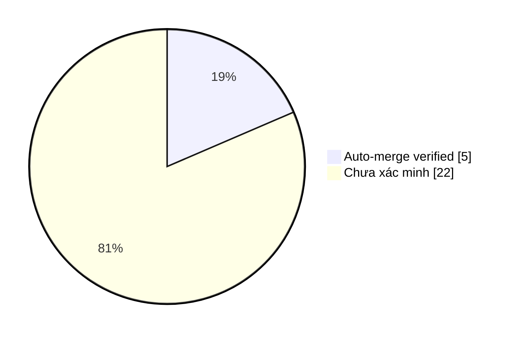

# Auto-Merge Collector · Evidence & Smart Insights

> Dữ liệu GitHub API; chỉ đánh dấu **AUTO-MERGED (verified)** khi collector
> nhận tín hiệu từ workflow auto-merge và xác thực PR, SHA cùng CI xanh.
> Các PR lịch sử không có bằng chứng được ghi **chưa xác minh nguồn merge**,
> không tự suy đoán là merge thủ công hay tự động.

Cập nhật: **2026-11-06 16:26 UTC** · Repository: `duykhang68/tetdinhmuiblog`

## 📊 Dashboard

| Chỉ số | Giá trị |
|---|---:|
| PR đã merge (tối đa 300 PR gần đây) | 27 |
| AUTO-MERGED có bằng chứng | 5 |
| Auto-merge PR thường | 1 |
| Auto-merge PR thay đổi workflow | 4 |
| Nguồn merge chưa xác minh | 22 |

### Phân bố bằng chứng

`Auto-merge ` ███░░░░░░░░░░░░░░░ **5/27**

## ✅ Vì sao từng PR được auto-merge?

| PR | Thời điểm UTC | Loại | CI HEAD | Bằng chứng & lý do |
|---|---|---|---|---|
| [#27](https://github.com/duykhang68/tetdinhmuiblog/pull/27) fix(ci): prevent researcher jobs being skipped by event | 2026-11-06T16:26:28Z | Workflow/config | ✅ | CI green trên HEAD `70559a0d`; GitHub chấp nhận merge; [Run #42252368788](https://github.com/duykhang68/tetdinhmuiblog/actions/runs/42252368788) |
| [#26](https://github.com/duykhang68/tetdinhmuiblog/pull/26) fix(ci): run quality gate for collector-generated main  | 2026-11-06T16:22:42Z | Workflow/config | ✅ | CI green trên HEAD `0b80f4ee`; GitHub chấp nhận merge; [Run #42251750204](https://github.com/duykhang68/tetdinhmuiblog/actions/runs/42251750204) |
| [#25](https://github.com/duykhang68/tetdinhmuiblog/pull/25) fix(ci): stop cancelling in-progress quality-gate runs | 2026-11-06T16:21:39Z | Workflow/config | ✅ | CI green trên HEAD `9a73e99b`; GitHub chấp nhận merge; [Run #42251562431](https://github.com/duykhang68/tetdinhmuiblog/actions/runs/42251562431) |
| [#24](https://github.com/duykhang68/tetdinhmuiblog/pull/24) docs: transform README into visual Blogger Studio dashb | 2026-11-06T16:20:36Z | Code/docs | ✅ | CI green trên HEAD `b44756a6`; GitHub chấp nhận merge; [Run #42251447389](https://github.com/duykhang68/tetdinhmuiblog/actions/runs/42251447389) |
| [#23](https://github.com/duykhang68/tetdinhmuiblog/pull/23) feat(ci): process auto-merges in separate 60-second PR  | 2026-11-06T16:17:55Z | Workflow/config | ✅ | CI green trên HEAD `950063a2`; GitHub chấp nhận merge; [Run #42251027089](https://github.com/duykhang68/tetdinhmuiblog/actions/runs/42251027089) |

## 🧠 Smart Insights

- **Tỷ lệ workflow trong các auto-merge đã xác minh:** 80.0% (4/5).
- **Quality gate:** 5 auto-merge có bằng chứng CI thành công trên SHA chính xác.
- **Bài học:** Kiểm tra SHA hiện tại giúp tránh dùng kết quả CI của commit cũ.
- **Bài học:** PR thay đổi GitHub Actions cần credential đủ quyền `Workflows: write`; CI xanh không tự cấp quyền.
- **Bài học:** Branch protection và khả năng merge do GitHub thực thi; collector chỉ phản ánh kết quả đã xảy ra.
- **Khoảng trống dữ liệu:** 22 PR đã merge chưa có bằng chứng collector; không tính là auto-merge.

## 🛡️ Giới hạn và phương pháp

- Chỉ tính những PR đã merge trong tối đa 300 PR đóng gần đây; dữ liệu tổng hợp không phải toàn bộ lịch sử.
- Collector ghi nhận sự kiện do workflow gửi, xác thực tên run, PR merged, exact SHA và CI check thành công.
- Trạng thái không conflict / branch rules được GitHub thực thi lúc merge thành công; không lưu ảnh chụp ruleset lịch sử.
- CI xanh là điều kiện cần, không phải bảo đảm thay đổi không có lỗi. Insights là quy tắc phân tích, không phải nhận định AI sinh tự động.
- Tệp sự kiện: `data/collector-events.json`; script tạo báo cáo: `collector.py`.
