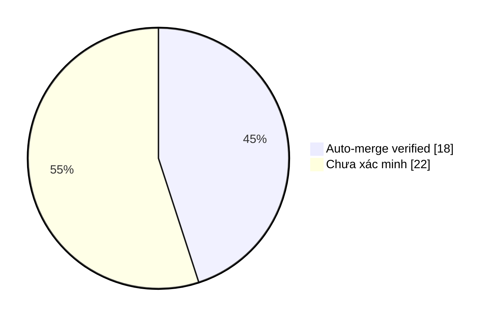

# Auto-Merge Collector · Evidence & Smart Insights

> Dữ liệu GitHub API; chỉ đánh dấu **AUTO-MERGED (verified)** khi collector
> nhận tín hiệu từ workflow auto-merge và xác thực PR, SHA cùng CI xanh.
> Các PR lịch sử không có bằng chứng được ghi **chưa xác minh nguồn merge**,
> không tự suy đoán là merge thủ công hay tự động.

Cập nhật: **2026-11-07 01:04 UTC** · Repository: `duykhang68/tetdinhmuiblog`

## 📊 Dashboard

| Chỉ số | Giá trị |
|---|---:|
| PR đã merge (tối đa 300 PR gần đây) | 40 |
| AUTO-MERGED có bằng chứng | 18 |
| Auto-merge PR thường | 13 |
| Auto-merge PR thay đổi workflow | 5 |
| Nguồn merge chưa xác minh | 22 |

### Phân bố bằng chứng

`Auto-merge ` ████████░░░░░░░░░░ **18/40**

## ✅ Vì sao từng PR được auto-merge?

| PR | Thời điểm UTC | Loại | CI HEAD | Bằng chứng & lý do |
|---|---|---|---|---|
| [#41](https://github.com/duykhang68/tetdinhmuiblog/pull/41) feat(editor): live GitHub Actions Queue in right sideba | 2026-11-07T01:04:31Z | Code/docs | ✅ | CI green trên HEAD `8b43b349`; GitHub chấp nhận merge; [Run #42321986154](https://github.com/duykhang68/tetdinhmuiblog/actions/runs/42321986154) |
| [#40](https://github.com/duykhang68/tetdinhmuiblog/pull/40) feat(collector): standalone live Markdown Insights dash | 2026-11-07T01:02:10Z | Code/docs | ✅ | CI green trên HEAD `2c26c114`; GitHub chấp nhận merge; [Run #42321760638](https://github.com/duykhang68/tetdinhmuiblog/actions/runs/42321760638) |
| [#39](https://github.com/duykhang68/tetdinhmuiblog/pull/39) feat: standalone CI / Quality Gate Insights dashboard w | 2026-11-07T01:01:04Z | Code/docs | ✅ | CI green trên HEAD `c3373331`; GitHub chấp nhận merge; [Run #42321649414](https://github.com/duykhang68/tetdinhmuiblog/actions/runs/42321649414) |
| [#38](https://github.com/duykhang68/tetdinhmuiblog/pull/38) feat: Research Insights standalone OAuth dashboard | 2026-11-07T00:56:57Z | Code/docs | ✅ | CI green trên HEAD `0d27395b`; GitHub chấp nhận merge; [Run #42321260979](https://github.com/duykhang68/tetdinhmuiblog/actions/runs/42321260979) |
| [#37](https://github.com/duykhang68/tetdinhmuiblog/pull/37) fix(series): support Series metadata and quota-safe pag | 2026-11-07T00:53:39Z | Code/docs | ✅ | CI green trên HEAD `8a691595`; GitHub chấp nhận merge; [Run #42320951254](https://github.com/duykhang68/tetdinhmuiblog/actions/runs/42320951254) |
| [#34](https://github.com/duykhang68/tetdinhmuiblog/pull/34) feat(editor): integrate Series writing, blueprints and  | 2026-11-07T00:50:33Z | Code/docs | ✅ | CI green trên HEAD `c94aff5c`; GitHub chấp nhận merge; [Run #42320653957](https://github.com/duykhang68/tetdinhmuiblog/actions/runs/42320653957) |
| [#36](https://github.com/duykhang68/tetdinhmuiblog/pull/36) docs(researcher): incident CI-86CFBCD21AE0 | 2026-11-07T00:48:49Z | Code/docs | ✅ | CI green trên HEAD `a4ee6f04`; GitHub chấp nhận merge; [Run #42320482803](https://github.com/duykhang68/tetdinhmuiblog/actions/runs/42320482803) |
| [#33](https://github.com/duykhang68/tetdinhmuiblog/pull/33) feat(blogger): host theme CSS/JS on Cloudflare Pages fr | 2026-11-07T00:39:49Z | Code/docs | ✅ | CI green trên HEAD `caea055e`; GitHub chấp nhận merge; [Run #42319561359](https://github.com/duykhang68/tetdinhmuiblog/actions/runs/42319561359) |
| [#32](https://github.com/duykhang68/tetdinhmuiblog/pull/32) feat(editor): live GitHub Smart Insights by closed PR l | 2026-11-06T23:39:30Z | Code/docs | ✅ | CI green trên HEAD `7cc378bf`; GitHub chấp nhận merge; [Run #42313335725](https://github.com/duykhang68/tetdinhmuiblog/actions/runs/42313335725) |
| [#31](https://github.com/duykhang68/tetdinhmuiblog/pull/31) style(editor): improve text contrast based on reference | 2026-11-06T23:20:49Z | Code/docs | ✅ | CI green trên HEAD `4a14c482`; GitHub chấp nhận merge; [Run #42311254580](https://github.com/duykhang68/tetdinhmuiblog/actions/runs/42311254580) |
| [#30](https://github.com/duykhang68/tetdinhmuiblog/pull/30) fix(quota): fail closed on Google limits and cap outbou | 2026-11-06T17:47:00Z | Code/docs | ✅ | CI green trên HEAD `305b8b43`; GitHub chấp nhận merge; [Run #42264742697](https://github.com/duykhang68/tetdinhmuiblog/actions/runs/42264742697) |
| [#29](https://github.com/duykhang68/tetdinhmuiblog/pull/29) fix: Cloudflare Blogger OAuth | 2026-11-06T17:11:42Z | Code/docs | ✅ | CI green trên HEAD `a40d5cfd`; GitHub chấp nhận merge; [Run #42259336978](https://github.com/duykhang68/tetdinhmuiblog/actions/runs/42259336978) |
| [#28](https://github.com/duykhang68/tetdinhmuiblog/pull/28) feat(devops): add one-minute current-failure auditor wi | 2026-11-06T16:33:02Z | Workflow/config | ✅ | CI green trên HEAD `91daf4b7`; GitHub chấp nhận merge; [Run #42253388396](https://github.com/duykhang68/tetdinhmuiblog/actions/runs/42253388396) |
| [#27](https://github.com/duykhang68/tetdinhmuiblog/pull/27) fix(ci): prevent researcher jobs being skipped by event | 2026-11-06T16:26:28Z | Workflow/config | ✅ | CI green trên HEAD `70559a0d`; GitHub chấp nhận merge; [Run #42252368788](https://github.com/duykhang68/tetdinhmuiblog/actions/runs/42252368788) |
| [#26](https://github.com/duykhang68/tetdinhmuiblog/pull/26) fix(ci): run quality gate for collector-generated main  | 2026-11-06T16:22:42Z | Workflow/config | ✅ | CI green trên HEAD `0b80f4ee`; GitHub chấp nhận merge; [Run #42251750204](https://github.com/duykhang68/tetdinhmuiblog/actions/runs/42251750204) |
| [#25](https://github.com/duykhang68/tetdinhmuiblog/pull/25) fix(ci): stop cancelling in-progress quality-gate runs | 2026-11-06T16:21:39Z | Workflow/config | ✅ | CI green trên HEAD `9a73e99b`; GitHub chấp nhận merge; [Run #42251562431](https://github.com/duykhang68/tetdinhmuiblog/actions/runs/42251562431) |
| [#24](https://github.com/duykhang68/tetdinhmuiblog/pull/24) docs: transform README into visual Blogger Studio dashb | 2026-11-06T16:20:36Z | Code/docs | ✅ | CI green trên HEAD `b44756a6`; GitHub chấp nhận merge; [Run #42251447389](https://github.com/duykhang68/tetdinhmuiblog/actions/runs/42251447389) |
| [#23](https://github.com/duykhang68/tetdinhmuiblog/pull/23) feat(ci): process auto-merges in separate 60-second PR  | 2026-11-06T16:17:55Z | Workflow/config | ✅ | CI green trên HEAD `950063a2`; GitHub chấp nhận merge; [Run #42251027089](https://github.com/duykhang68/tetdinhmuiblog/actions/runs/42251027089) |

## 🧠 Smart Insights

- **Tỷ lệ workflow trong các auto-merge đã xác minh:** 27.8% (5/18).
- **Quality gate:** 18 auto-merge có bằng chứng CI thành công trên SHA chính xác.
- **Bài học:** Kiểm tra SHA hiện tại giúp tránh dùng kết quả CI của commit cũ.
- **Bài học:** PR thay đổi GitHub Actions cần credential đủ quyền `Workflows: write`; CI xanh không tự cấp quyền.
- **Bài học:** Branch protection và khả năng merge do GitHub thực thi; collector chỉ phản ánh kết quả đã xảy ra.
- **Khoảng trống dữ liệu:** 22 PR đã merge chưa có bằng chứng collector; không tính là auto-merge.

## 🛡️ Giới hạn và phương pháp

- Chỉ tính những PR đã merge trong tối đa 300 PR đóng gần đây; dữ liệu tổng hợp không phải toàn bộ lịch sử.
- Collector ghi nhận sự kiện do workflow gửi, xác thực tên run, PR merged, exact SHA và CI check thành công.
- Trạng thái không conflict / branch rules được GitHub thực thi lúc merge thành công; không lưu ảnh chụp ruleset lịch sử.
- CI xanh là điều kiện cần, không phải bảo đảm thay đổi không có lỗi. Insights là quy tắc phân tích, không phải nhận định AI sinh tự động.
- Tệp sự kiện: `data/collector-events.json`; script tạo báo cáo: `collector.py`.
