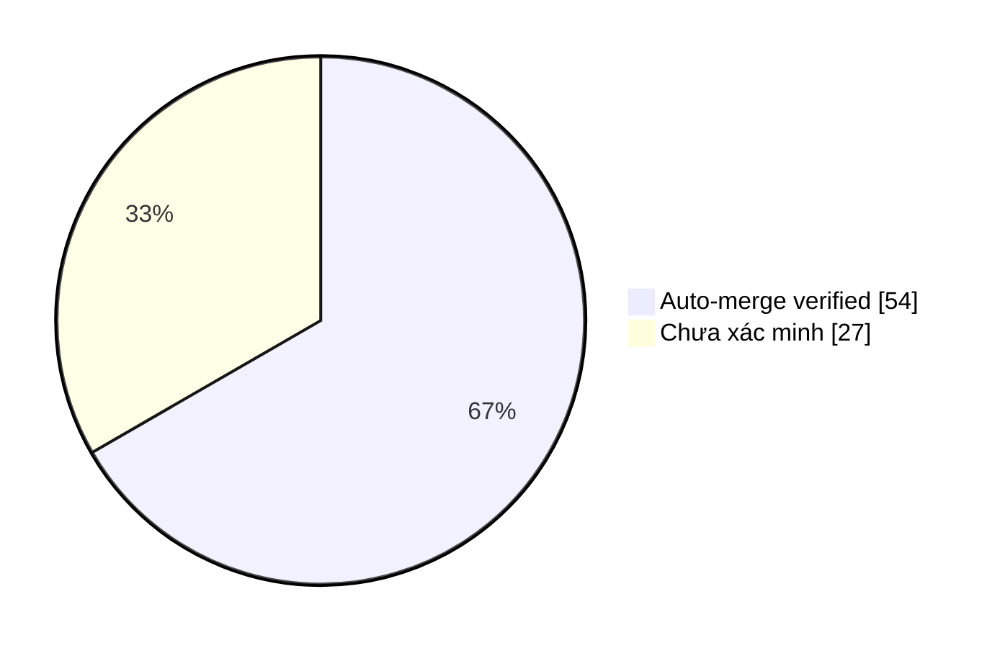

# Auto-Merge Collector · Evidence & Smart Insights

> Dữ liệu GitHub API; chỉ đánh dấu **AUTO-MERGED (verified)** khi collector
> nhận tín hiệu từ workflow auto-merge và xác thực PR, SHA cùng CI xanh.
> Các PR lịch sử không có bằng chứng được ghi **chưa xác minh nguồn merge**,
> không tự suy đoán là merge thủ công hay tự động.

Cập nhật: **2026-11-07 04:47 UTC** · Repository: `duykhang68/tetdinhmuiblog`

## 📊 Dashboard

| Chỉ số | Giá trị |
|---|---:|
| PR đã merge (tối đa 300 PR gần đây) | 81 |
| AUTO-MERGED có bằng chứng | 54 |
| Auto-merge PR thường | 48 |
| Auto-merge PR thay đổi workflow | 6 |
| Nguồn merge chưa xác minh | 27 |

### Phân bố bằng chứng

`Auto-merge ` ████████████░░░░░░ **54/81**

## ✅ Vì sao từng PR được auto-merge?

| PR | Thời điểm UTC | Loại | CI HEAD | Bằng chứng & lý do |
|---|---|---|---|---|
| [#82](https://github.com/duykhang68/tetdinhmuiblog/pull/82) feat(payroll): private PDF payslip viewer, smart formul | 2026-11-07T04:46:52Z | Code/docs | ✅ | CI green trên HEAD `9b9a7dde`; GitHub chấp nhận merge; [Run #42339907415](https://github.com/duykhang68/tetdinhmuiblog/actions/runs/42339907415) |
| [#81](https://github.com/duykhang68/tetdinhmuiblog/pull/81) fix(editor): auto-discover Google Drive OAuth Client ID | 2026-11-07T04:24:51Z | Code/docs | ✅ | CI green trên HEAD `72b94338`; GitHub chấp nhận merge; [Run #42338338273](https://github.com/duykhang68/tetdinhmuiblog/actions/runs/42338338273) |
| [#80](https://github.com/duykhang68/tetdinhmuiblog/pull/80) fix(highlands): verify KCN Bau Bang store via ShopID an | 2026-11-07T04:23:40Z | Code/docs | ✅ | CI green trên HEAD `ce9a6e2d`; GitHub chấp nhận merge; [Run #42338247679](https://github.com/duykhang68/tetdinhmuiblog/actions/runs/42338247679) |
| [#79](https://github.com/duykhang68/tetdinhmuiblog/pull/79) fix(highlands): recover real paper receipt OCR despite  | 2026-11-07T04:12:23Z | Code/docs | ✅ | CI green trên HEAD `591dc736`; GitHub chấp nhận merge; [Run #42337393485](https://github.com/duykhang68/tetdinhmuiblog/actions/runs/42337393485) |
| [#78](https://github.com/duykhang68/tetdinhmuiblog/pull/78) fix(highlands): count small eligible purchases in tier  | 2026-11-07T03:59:16Z | Code/docs | ✅ | CI green trên HEAD `93ef9c16`; GitHub chấp nhận merge; [Run #42336391799](https://github.com/duykhang68/tetdinhmuiblog/actions/runs/42336391799) |
| [#77](https://github.com/duykhang68/tetdinhmuiblog/pull/77) feat(highlands): standalone Rewards & Insights with POS | 2026-11-07T03:57:08Z | Code/docs | ✅ | CI green trên HEAD `33badc61`; GitHub chấp nhận merge; [Run #42336251844](https://github.com/duykhang68/tetdinhmuiblog/actions/runs/42336251844) |
| [#75](https://github.com/duykhang68/tetdinhmuiblog/pull/75) style(starbucks): Reddit Light borders and green payabl | 2026-11-07T03:43:40Z | Code/docs | ✅ | CI green trên HEAD `116721e7`; GitHub chấp nhận merge; [Run #42335286797](https://github.com/duykhang68/tetdinhmuiblog/actions/runs/42335286797) |
| [#74](https://github.com/duykhang68/tetdinhmuiblog/pull/74) feat(starbucks): Google Drive sync with 3-minute autosa | 2026-11-07T03:42:15Z | Code/docs | ✅ | CI green trên HEAD `4048ac60`; GitHub chấp nhận merge; [Run #42335185236](https://github.com/duykhang68/tetdinhmuiblog/actions/runs/42335185236) |
| [#73](https://github.com/duykhang68/tetdinhmuiblog/pull/73) style(editor): make writing status bar bold and visuall | 2026-11-07T03:34:54Z | Code/docs | ✅ | CI green trên HEAD `6362b6c8`; GitHub chấp nhận merge; [Run #42334646380](https://github.com/duykhang68/tetdinhmuiblog/actions/runs/42334646380) |
| [#72](https://github.com/duykhang68/tetdinhmuiblog/pull/72) fix(starbucks): autofill OCR fee/discount reasons and h | 2026-11-07T03:32:59Z | Code/docs | ✅ | CI green trên HEAD `435b7c84`; GitHub chấp nhận merge; [Run #42334495702](https://github.com/duykhang68/tetdinhmuiblog/actions/runs/42334495702) |
| [#71](https://github.com/duykhang68/tetdinhmuiblog/pull/71) fix(starbucks): autofill original 80k and missing 5k su | 2026-11-07T03:28:13Z | Code/docs | ✅ | CI green trên HEAD `d795cc47`; GitHub chấp nhận merge; [Run #42334135277](https://github.com/duykhang68/tetdinhmuiblog/actions/runs/42334135277) |
| [#70](https://github.com/duykhang68/tetdinhmuiblog/pull/70) fix(expenses): automatically reuse Editor Google OAuth  | 2026-11-07T03:25:32Z | Code/docs | ✅ | CI green trên HEAD `1cfa9e9e`; GitHub chấp nhận merge; [Run #42333940994](https://github.com/duykhang68/tetdinhmuiblog/actions/runs/42333940994) |
| [#68](https://github.com/duykhang68/tetdinhmuiblog/pull/68) fix(starbucks): clean OCR artifacts from store and item | 2026-11-07T03:15:11Z | Code/docs | ✅ | CI green trên HEAD `274f1a7b`; GitHub chấp nhận merge; [Run #42333121584](https://github.com/duykhang68/tetdinhmuiblog/actions/runs/42333121584) |
| [#67](https://github.com/duykhang68/tetdinhmuiblog/pull/67) fix(blogger): căn đều hai lề nội dung bài viết | 2026-11-07T03:11:11Z | Code/docs | ✅ | CI green trên HEAD `3f1d838b`; GitHub chấp nhận merge; [Run #42332802174](https://github.com/duykhang68/tetdinhmuiblog/actions/runs/42332802174) |
| [#65](https://github.com/duykhang68/tetdinhmuiblog/pull/65) fix(blogger): light Reddit-inspired reading UI colors a | 2026-11-07T03:06:30Z | Code/docs | ✅ | CI green trên HEAD `c744b5a4`; GitHub chấp nhận merge; [Run #42332422276](https://github.com/duykhang68/tetdinhmuiblog/actions/runs/42332422276) |
| [#64](https://github.com/duykhang68/tetdinhmuiblog/pull/64) feat(branding): standalone Tet Dinh Mui Branding Guidel | 2026-11-07T03:04:26Z | Code/docs | ✅ | CI green trên HEAD `6155bd1c`; GitHub chấp nhận merge; [Run #42332249417](https://github.com/duykhang68/tetdinhmuiblog/actions/runs/42332249417) |
| [#63](https://github.com/duykhang68/tetdinhmuiblog/pull/63) feat(starbucks): browser OCR import and autofill from r | 2026-11-07T03:00:04Z | Code/docs | ✅ | CI green trên HEAD `e516ebf9`; GitHub chấp nhận merge; [Run #42331885813](https://github.com/duykhang68/tetdinhmuiblog/actions/runs/42331885813) |
| [#62](https://github.com/duykhang68/tetdinhmuiblog/pull/62) style(expenses): Reddit OrangeRed light-mode visual reb | 2026-11-07T02:54:23Z | Code/docs | ✅ | CI green trên HEAD `81ae1868`; GitHub chấp nhận merge; [Run #42331471525](https://github.com/duykhang68/tetdinhmuiblog/actions/runs/42331471525) |
| [#61](https://github.com/duykhang68/tetdinhmuiblog/pull/61) feat(starbucks): capture receipt subtotal, discounts an | 2026-11-07T02:50:57Z | Code/docs | ✅ | CI green trên HEAD `74068fe7`; GitHub chấp nhận merge; [Run #42331213598](https://github.com/duykhang68/tetdinhmuiblog/actions/runs/42331213598) |
| [#60](https://github.com/duykhang68/tetdinhmuiblog/pull/60) feat(expenses): Daily Expenses & Insights with custom c | 2026-11-07T02:46:18Z | Code/docs | ✅ | CI green trên HEAD `0eb1a43c`; GitHub chấp nhận merge; [Run #42330847846](https://github.com/duykhang68/tetdinhmuiblog/actions/runs/42330847846) |
| [#59](https://github.com/duykhang68/tetdinhmuiblog/pull/59) feat(starbucks): add optional Order ID to transactions  | 2026-11-07T02:43:59Z | Code/docs | ✅ | CI green trên HEAD `c7e3d49c`; GitHub chấp nhận merge; [Run #42330664653](https://github.com/duykhang68/tetdinhmuiblog/actions/runs/42330664653) |
| [#58](https://github.com/duykhang68/tetdinhmuiblog/pull/58) fix(rollback): live-only GitHub stats + 5-minute auto/m | 2026-11-07T02:31:22Z | Code/docs | ✅ | CI green trên HEAD `57051d51`; GitHub chấp nhận merge; [Run #42329648227](https://github.com/duykhang68/tetdinhmuiblog/actions/runs/42329648227) |
| [#57](https://github.com/duykhang68/tetdinhmuiblog/pull/57) feat: Reddit Light Rollback ID Dashboard with guarded r | 2026-11-07T02:18:47Z | Workflow/config | ✅ | CI green trên HEAD `b4ce56a0`; GitHub chấp nhận merge; [Run #42328590872](https://github.com/duykhang68/tetdinhmuiblog/actions/runs/42328590872) |
| [#56](https://github.com/duykhang68/tetdinhmuiblog/pull/56) feat(series): thêm mẫu Review phim chiếu rạp và Trên ta | 2026-11-07T02:10:05Z | Code/docs | ✅ | CI green trên HEAD `0c67f7b7`; GitHub chấp nhận merge; [Run #42327834238](https://github.com/duykhang68/tetdinhmuiblog/actions/runs/42327834238) |
| [#55](https://github.com/duykhang68/tetdinhmuiblog/pull/55) feat(editor): Schedule a Post via Blogger API + Markdow | 2026-11-07T01:47:39Z | Code/docs | ✅ | CI green trên HEAD `05e4091f`; GitHub chấp nhận merge; [Run #42325921828](https://github.com/duykhang68/tetdinhmuiblog/actions/runs/42325921828) |
| [#53](https://github.com/duykhang68/tetdinhmuiblog/pull/53) feat: Starbucks Rewards & Insights — Reddit light dashb | 2026-11-07T01:41:15Z | Code/docs | ✅ | CI green trên HEAD `225f2e1c`; GitHub chấp nhận merge; [Run #42325386004](https://github.com/duykhang68/tetdinhmuiblog/actions/runs/42325386004) |
| [#54](https://github.com/duykhang68/tetdinhmuiblog/pull/54) fix: ưu tiên VITE_GOOGLE_CLIENT_ID cho Google Drive trê | 2026-11-07T01:40:06Z | Code/docs | ✅ | CI green trên HEAD `da9940be`; GitHub chấp nhận merge; [Run #42325262647](https://github.com/duykhang68/tetdinhmuiblog/actions/runs/42325262647) |
| [#52](https://github.com/duykhang68/tetdinhmuiblog/pull/52) docs: hướng dẫn cấu hình GITHUB_TOKEN Cloudflare cho Re | 2026-11-07T01:29:37Z | Code/docs | ✅ | CI green trên HEAD `eaa7dcc6`; GitHub chấp nhận merge; [Run #42324331505](https://github.com/duykhang68/tetdinhmuiblog/actions/runs/42324331505) |
| [#50](https://github.com/duykhang68/tetdinhmuiblog/pull/50) fix: restore Research Insights GitHub data and eliminat | 2026-11-07T01:24:02Z | Code/docs | ✅ | CI green trên HEAD `7424d4ba`; GitHub chấp nhận merge; [Run #42323823599](https://github.com/duykhang68/tetdinhmuiblog/actions/runs/42323823599) |
| [#49](https://github.com/duykhang68/tetdinhmuiblog/pull/49) feat(dev): tự đồng bộ GitHub → Local Editor, HMR an toà | 2026-11-07T01:22:59Z | Code/docs | ✅ | CI green trên HEAD `7595397b`; GitHub chấp nhận merge; [Run #42323753042](https://github.com/duykhang68/tetdinhmuiblog/actions/runs/42323753042) |
| [#48](https://github.com/duykhang68/tetdinhmuiblog/pull/48) feat(editor): add quick access links to Insights pages  | 2026-11-07T01:19:43Z | Code/docs | ✅ | CI green trên HEAD `fbdc25d1`; GitHub chấp nhận merge; [Run #42323443750](https://github.com/duykhang68/tetdinhmuiblog/actions/runs/42323443750) |
| [#46](https://github.com/duykhang68/tetdinhmuiblog/pull/46) feat: connect Research Insights website traffic to veri | 2026-11-07T01:16:13Z | Code/docs | ✅ | CI green trên HEAD `8a9156a7`; GitHub chấp nhận merge; [Run #42323121552](https://github.com/duykhang68/tetdinhmuiblog/actions/runs/42323121552) |
| [#47](https://github.com/duykhang68/tetdinhmuiblog/pull/47) fix(editor): remove workspace loading splash on homepag | 2026-11-07T01:12:49Z | Code/docs | ✅ | CI green trên HEAD `d6ec523e`; GitHub chấp nhận merge; [Run #42322793574](https://github.com/duykhang68/tetdinhmuiblog/actions/runs/42322793574) |
| [#44](https://github.com/duykhang68/tetdinhmuiblog/pull/44) fix(quality-gate): diagnose GitHub API auth and preserv | 2026-11-07T01:10:49Z | Code/docs | ✅ | CI green trên HEAD `14d3ab25`; GitHub chấp nhận merge; [Run #42322591539](https://github.com/duykhang68/tetdinhmuiblog/actions/runs/42322591539) |
| [#43](https://github.com/duykhang68/tetdinhmuiblog/pull/43) style(collector): replace dark UI with permanent light  | 2026-11-07T01:09:19Z | Code/docs | ✅ | CI green trên HEAD `ab2334c6`; GitHub chấp nhận merge; [Run #42322453259](https://github.com/duykhang68/tetdinhmuiblog/actions/runs/42322453259) |
| [#42](https://github.com/duykhang68/tetdinhmuiblog/pull/42) fix: recover Quality Gate pipeline sync via public GitH | 2026-11-07T01:07:28Z | Code/docs | ✅ | CI green trên HEAD `5bae7630`; GitHub chấp nhận merge; [Run #42322277332](https://github.com/duykhang68/tetdinhmuiblog/actions/runs/42322277332) |
| [#41](https://github.com/duykhang68/tetdinhmuiblog/pull/41) feat(editor): live GitHub Actions Queue in right sideba | 2026-11-07T01:04:31Z | Code/docs | ✅ | CI green trên HEAD `8b43b349`; GitHub chấp nhận merge; [Run #42321986154](https://github.com/duykhang68/tetdinhmuiblog/actions/runs/42321986154) |
| [#40](https://github.com/duykhang68/tetdinhmuiblog/pull/40) feat(collector): standalone live Markdown Insights dash | 2026-11-07T01:02:10Z | Code/docs | ✅ | CI green trên HEAD `2c26c114`; GitHub chấp nhận merge; [Run #42321760638](https://github.com/duykhang68/tetdinhmuiblog/actions/runs/42321760638) |
| [#39](https://github.com/duykhang68/tetdinhmuiblog/pull/39) feat: standalone CI / Quality Gate Insights dashboard w | 2026-11-07T01:01:04Z | Code/docs | ✅ | CI green trên HEAD `c3373331`; GitHub chấp nhận merge; [Run #42321649414](https://github.com/duykhang68/tetdinhmuiblog/actions/runs/42321649414) |
| [#38](https://github.com/duykhang68/tetdinhmuiblog/pull/38) feat: Research Insights standalone OAuth dashboard | 2026-11-07T00:56:57Z | Code/docs | ✅ | CI green trên HEAD `0d27395b`; GitHub chấp nhận merge; [Run #42321260979](https://github.com/duykhang68/tetdinhmuiblog/actions/runs/42321260979) |
| [#37](https://github.com/duykhang68/tetdinhmuiblog/pull/37) fix(series): support Series metadata and quota-safe pag | 2026-11-07T00:53:39Z | Code/docs | ✅ | CI green trên HEAD `8a691595`; GitHub chấp nhận merge; [Run #42320951254](https://github.com/duykhang68/tetdinhmuiblog/actions/runs/42320951254) |
| [#34](https://github.com/duykhang68/tetdinhmuiblog/pull/34) feat(editor): integrate Series writing, blueprints and  | 2026-11-07T00:50:33Z | Code/docs | ✅ | CI green trên HEAD `c94aff5c`; GitHub chấp nhận merge; [Run #42320653957](https://github.com/duykhang68/tetdinhmuiblog/actions/runs/42320653957) |
| [#36](https://github.com/duykhang68/tetdinhmuiblog/pull/36) docs(researcher): incident CI-86CFBCD21AE0 | 2026-11-07T00:48:49Z | Code/docs | ✅ | CI green trên HEAD `a4ee6f04`; GitHub chấp nhận merge; [Run #42320482803](https://github.com/duykhang68/tetdinhmuiblog/actions/runs/42320482803) |
| [#33](https://github.com/duykhang68/tetdinhmuiblog/pull/33) feat(blogger): host theme CSS/JS on Cloudflare Pages fr | 2026-11-07T00:39:49Z | Code/docs | ✅ | CI green trên HEAD `caea055e`; GitHub chấp nhận merge; [Run #42319561359](https://github.com/duykhang68/tetdinhmuiblog/actions/runs/42319561359) |
| [#32](https://github.com/duykhang68/tetdinhmuiblog/pull/32) feat(editor): live GitHub Smart Insights by closed PR l | 2026-11-06T23:39:30Z | Code/docs | ✅ | CI green trên HEAD `7cc378bf`; GitHub chấp nhận merge; [Run #42313335725](https://github.com/duykhang68/tetdinhmuiblog/actions/runs/42313335725) |
| [#31](https://github.com/duykhang68/tetdinhmuiblog/pull/31) style(editor): improve text contrast based on reference | 2026-11-06T23:20:49Z | Code/docs | ✅ | CI green trên HEAD `4a14c482`; GitHub chấp nhận merge; [Run #42311254580](https://github.com/duykhang68/tetdinhmuiblog/actions/runs/42311254580) |
| [#30](https://github.com/duykhang68/tetdinhmuiblog/pull/30) fix(quota): fail closed on Google limits and cap outbou | 2026-11-06T17:47:00Z | Code/docs | ✅ | CI green trên HEAD `305b8b43`; GitHub chấp nhận merge; [Run #42264742697](https://github.com/duykhang68/tetdinhmuiblog/actions/runs/42264742697) |
| [#29](https://github.com/duykhang68/tetdinhmuiblog/pull/29) fix: Cloudflare Blogger OAuth | 2026-11-06T17:11:42Z | Code/docs | ✅ | CI green trên HEAD `a40d5cfd`; GitHub chấp nhận merge; [Run #42259336978](https://github.com/duykhang68/tetdinhmuiblog/actions/runs/42259336978) |
| [#28](https://github.com/duykhang68/tetdinhmuiblog/pull/28) feat(devops): add one-minute current-failure auditor wi | 2026-11-06T16:33:02Z | Workflow/config | ✅ | CI green trên HEAD `91daf4b7`; GitHub chấp nhận merge; [Run #42253388396](https://github.com/duykhang68/tetdinhmuiblog/actions/runs/42253388396) |
| [#27](https://github.com/duykhang68/tetdinhmuiblog/pull/27) fix(ci): prevent researcher jobs being skipped by event | 2026-11-06T16:26:28Z | Workflow/config | ✅ | CI green trên HEAD `70559a0d`; GitHub chấp nhận merge; [Run #42252368788](https://github.com/duykhang68/tetdinhmuiblog/actions/runs/42252368788) |
| [#26](https://github.com/duykhang68/tetdinhmuiblog/pull/26) fix(ci): run quality gate for collector-generated main  | 2026-11-06T16:22:42Z | Workflow/config | ✅ | CI green trên HEAD `0b80f4ee`; GitHub chấp nhận merge; [Run #42251750204](https://github.com/duykhang68/tetdinhmuiblog/actions/runs/42251750204) |
| [#25](https://github.com/duykhang68/tetdinhmuiblog/pull/25) fix(ci): stop cancelling in-progress quality-gate runs | 2026-11-06T16:21:39Z | Workflow/config | ✅ | CI green trên HEAD `9a73e99b`; GitHub chấp nhận merge; [Run #42251562431](https://github.com/duykhang68/tetdinhmuiblog/actions/runs/42251562431) |
| [#24](https://github.com/duykhang68/tetdinhmuiblog/pull/24) docs: transform README into visual Blogger Studio dashb | 2026-11-06T16:20:36Z | Code/docs | ✅ | CI green trên HEAD `b44756a6`; GitHub chấp nhận merge; [Run #42251447389](https://github.com/duykhang68/tetdinhmuiblog/actions/runs/42251447389) |
| [#23](https://github.com/duykhang68/tetdinhmuiblog/pull/23) feat(ci): process auto-merges in separate 60-second PR  | 2026-11-06T16:17:55Z | Workflow/config | ✅ | CI green trên HEAD `950063a2`; GitHub chấp nhận merge; [Run #42251027089](https://github.com/duykhang68/tetdinhmuiblog/actions/runs/42251027089) |

## 🧠 Smart Insights

- **Tỷ lệ workflow trong các auto-merge đã xác minh:** 11.1% (6/54).
- **Quality gate:** 54 auto-merge có bằng chứng CI thành công trên SHA chính xác.
- **Bài học:** Kiểm tra SHA hiện tại giúp tránh dùng kết quả CI của commit cũ.
- **Bài học:** PR thay đổi GitHub Actions cần credential đủ quyền `Workflows: write`; CI xanh không tự cấp quyền.
- **Bài học:** Branch protection và khả năng merge do GitHub thực thi; collector chỉ phản ánh kết quả đã xảy ra.
- **Khoảng trống dữ liệu:** 27 PR đã merge chưa có bằng chứng collector; không tính là auto-merge.

## 🛡️ Giới hạn và phương pháp

- Chỉ tính những PR đã merge trong tối đa 300 PR đóng gần đây; dữ liệu tổng hợp không phải toàn bộ lịch sử.
- Collector ghi nhận sự kiện do workflow gửi, xác thực tên run, PR merged, exact SHA và CI check thành công.
- Trạng thái không conflict / branch rules được GitHub thực thi lúc merge thành công; không lưu ảnh chụp ruleset lịch sử.
- CI xanh là điều kiện cần, không phải bảo đảm thay đổi không có lỗi. Insights là quy tắc phân tích, không phải nhận định AI sinh tự động.
- Tệp sự kiện: `data/collector-events.json`; script tạo báo cáo: `collector.py`.
